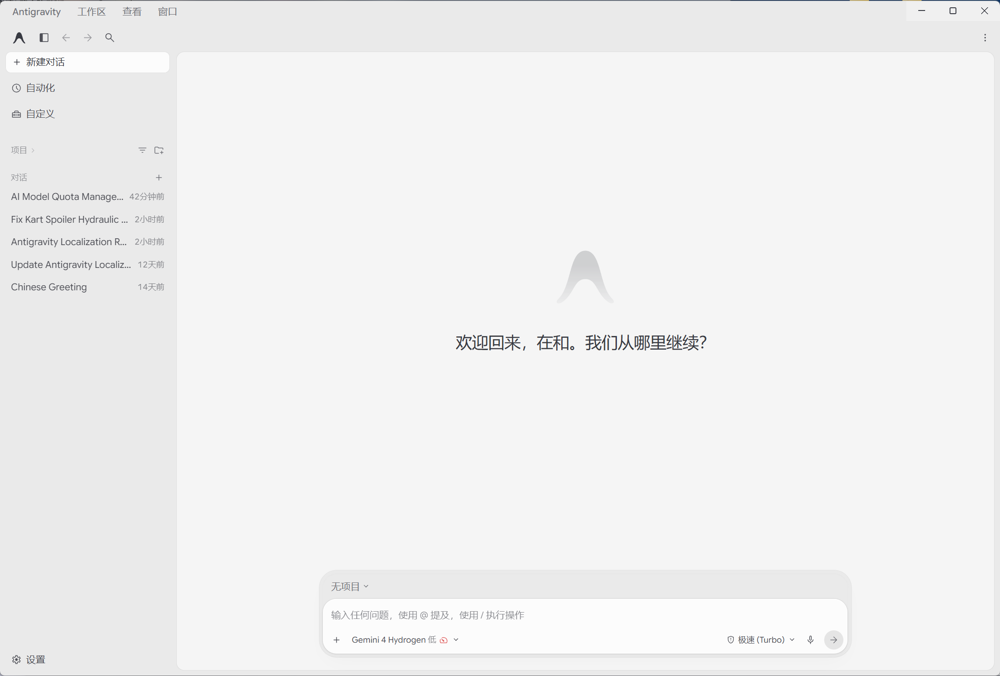

# Antigravity-zh-CN

一个为 Google Antigravity 桌面端提供完整中文界面的开源汉化补丁

---

## 📖 项目简介

**Antigravity v2.33.0 一键汉化补丁** - 为 Google Antigravity 桌面端提供完整的中文界面支持。

**项目来自**[Antigravity-zh-CN](https://github.com/MIMICTE/Antigravity-zh-CN)

## ✨ 核心特性

- 🚀 **零依赖 (Zero Dependencies)** - 自带纯原生 Python 编写的 ASAR 解析与打包算法，无需安装 Node.js，无需 npm，无需 `asar` 命令行工具
- 🎯 **智能文本匹配** - 采用底层 `indexOf` 碎片化重组与 CSS 伪类多态匹配策略，完美绕过 Webpack 代码分割导致的汉化失效问题
- 🛡️ **纯净可逆** - 还原脚本可彻底抹除所有汉化残留，确保随时能"无损回滚"至纯血官方英文版

---

**【Windows 用户使用方法】**
1. 下载 `Antigravity-zh-CN-v2.33.0.zip` 并解压
2. 双击运行 `一键汉化.bat` 执行汉化（双击 `一键还原.bat` 还原）。

---

## 💡 技术原理

本项目利用 Electron 框架机制实现汉化：

### 1. 免打包劫持 (Unpacked Patching)
禁用官方 `app.asar` 文件，迫使软件读取注入了汉化代码的解包 `app` 文件夹。

### 2. 动态 DOM 拦截 (Dynamic DOM Interception)
在 `preload.js` 中注入 `MutationObserver`，实时监控页面 DOM 变化并替换英文文本为中文。

### 3. 原生 ASAR 解析器
使用纯 Python 实现的 ASAR 文件格式解析器，零外部依赖。

## ⚠️ 已知限制

- **思考日志为英文** - 受限于大模型的即时流式输出架构，智能体后台生成的思考日志（`Thought` 过程）无法汉化，但所有最终回复与前端界面均已 100% 汉化
- **版本依赖** - 针对 Antigravity v2.33.0 深度优化，其他版本亦具备高度兼容性

## 📸 效果展示

*汉化后的 Antigravity 界面 - 所有文本已完全汉化*

**界面完全汉化包括：**
- ✅ 侧边栏菜单（新建对话、历史对话、计划任务/幕僚长、项目与工作区）
- ✅ 顶部导航栏、系统托盘菜单及原生右键快捷菜单
- ✅ 输入框提示文本、旁支提问 (Side Question)、分支对话 (Fork) 和模型选择器
- ✅ v2.33.0 全新设置页面（权限预设 V2、沙盒配置、内置浏览器、语音与提示音、钩子 Hooks、已关联账号、远程控制与 WSL）
- ✅ 底层终端操作权限请求弹窗、保存规则选项及动态状态提示

## 🔐 安全性说明

本项目是完全开源和安全的：

### ✅ 我们做了什么

- **仅修改界面文本** - 只在前端层面替换显示文本，不涉及网络通信、数据收集、账号信息访问
- **开源透明** - 所有代码完全开源，无混淆、无加密、无隐藏逻辑
- **可逆操作** - 提供完整的还原机制，一键恢复原版
- **零外部依赖** - 纯 Python 标准库实现，不连接外部服务器

